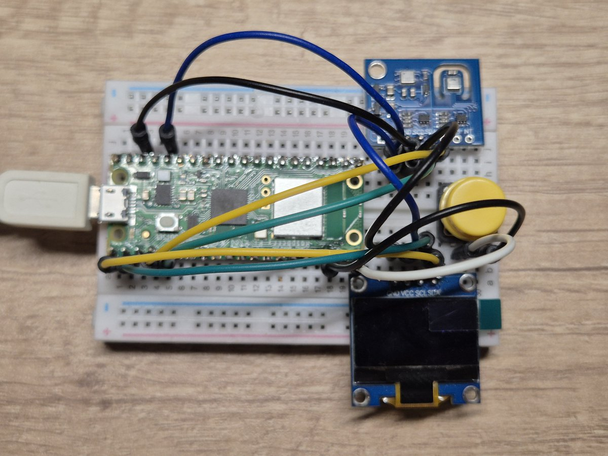

# Pico-Prosty_miernik_powietrza

**Prosty miernik powietrza** na Raspberry Pi Pico W — temperatura, wilgotność i jakość powietrza na OLED.

Język dokumentacji: **polski**. Kod: **MicroPython**.  
Cel: żeby **inny majsterkowicz (jak Marek) mógł to powtórzyć u siebie** — od lutowania pinów do pierwszego odczytu.

To **publiczna, uproszczona** wersja linii **SzklarniaPico**: bez Wi‑Fi i bez WWW. Tylko OLED + czujniki + przycisk.

> **Not Polish?** Use your browser **Translator** on this page.  
> Hardware and file names are universal.



**Wątek budowy na X:** [od zera do działającego OLED](https://x.com/GrzesiekHOBBY/status/2114417301910966423)

---

## Co zobaczysz na ekranie

| Strona | Co pokazuje |
|--------|-------------|
| **Klimat** | temperatura °C, wilgotność % |
| **Jakość powietrza** | ocena 1–5 po polsku (+ „rozgrzewka…” na start) |
| **eCO2** | szacunek CO₂ |
| **TVOC** | lotne związki organiczne |

Przycisk: następna strona (i budzi ekran). Po minucie OLED zasypia, żeby oszczędzać.

---

## Części (BOM)

| # | Część | Uwagi |
|---|--------|--------|
| 1 | Raspberry Pi Pico W | z pinami albo do dolutowania |
| 2 | Moduł AHT21 + ENS160 | jedna niebieska płytka „combo” |
| 3 | OLED 0,96″ I2C | zwykle 128×64, 4 piny |
| 4 | Przycisk taktylny | 6×6 mm |
| 5 | Płytka stykowa + przewody | |

Narzędzia: lutownica (tylko do pinów Pico), kabel USB z danymi, program **Thonny**, język **MicroPython**.

---

## Mapa pinów (dwie osobne szyny I2C)

Żeby OLED i czujniki się nie gryzły, każde ma swoją szynę (SDA = dane, SCL = zegar).

| Urządzenie | SDA / SCL | Zasilanie |
|------------|-----------|-----------|
| OLED | **GP0** / **GP1** | 3,3 V + GND |
| AHT21 + ENS160 | **GP2** / **GP3** | **3,3 V** (nie VIN) + GND |
| Przycisk | **GP15** ↔ GND | — |

Adresy: OLED `0x3C`, AHT21 `0x38`, ENS160 `0x53`.  
Na module czujników piny ADD / CS / INT zostaw wolne.

Mapa w kodzie: [`pins.py`](pins.py).


---

## Start w 4 testach (Thonny)

1. Wgraj MicroPython na Pico W.  
2. Skopiuj wszystkie pliki `.py` z tego repo na Pico.  
3. Uruchamiaj **po kolei** (Stop przed następnym):

| Kolejność | Plik | Co ma wyjść |
|-----------|------|-------------|
| 1 | `test_i2c_skan.py` | OLED: `0x3c` · czujniki: `0x38`, `0x53` |
| 2 | `test_przycisk.py` | reakcja na wciśnięcie |
| 3 | `test_oled.py` | tekst na ekranie |
| 4 | `test_czujniki.py` | odczyty w konsoli |

4. Odpal [`main.py`](main.py) — albo zapisz go jako `main.py` na Pico, żeby startował po podłączeniu USB.

---

## Ważne o czujniku jakości (ENS160)

- pierwsze **~3 minuty** po włączeniu: na OLED widać „rozgrzewka…” — to normalne  
- przy pierwszym użyciu warto trzymać zasilanie dłużej (nawet do doby), żeby kalibracja się ustabilizowała  

---

## Pliki w repozytorium

```text
Pico-Prosty_miernik_powietrza/
├── README.md
├── LICENSE                 ← MIT
├── .gitignore
├── main.py                 ← program główny
├── pins.py                 ← piny w jednym miejscu
├── aht21.py ens160.py ssd1306.py
├── test_*.py               ← diagnostyka montażu
└── media/                  ← zdjęcia z budowy
```

---

## Mobilnie (opcjonalnie, na później)

Najprościej: **powerbank** na USB Pico.  
Albo bateria → pin **VSYS** + GND (nie prosto w 3V3). Szczegóły zostawiamy na kolejną wersję.

---

## Linia SzklarniaPico

To repo to **publiczny start** linii. U autora są też prywatne etapy z WWW LAN (`Pico-Miernik_powietrza`) i stacją pogody (`Pico-Stacja_pogody`) — tu celowo zostawiamy tylko OLED + czujniki.

---

## Licencja

[MIT](LICENSE) — ucz się, buduj, poprawiaj. Mile widziana wzmianka „SzklarniaPico” / Grzesiek Hobby.

Projekt: **Grzesiek Hobby** · X: [@GrzesiekHOBBY](https://x.com/GrzesiekHOBBY) · hashtag (plan): `#SzklarniaPico`
