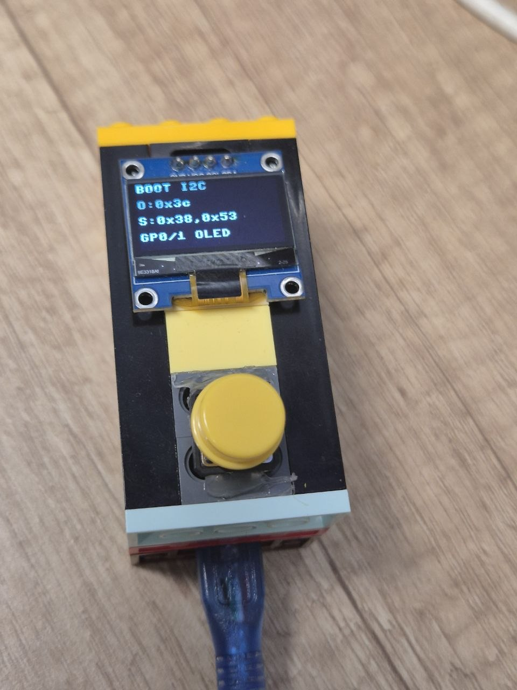
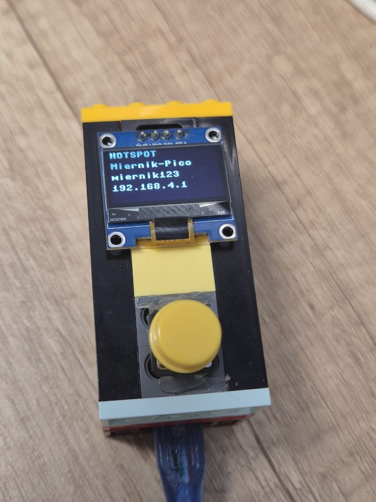
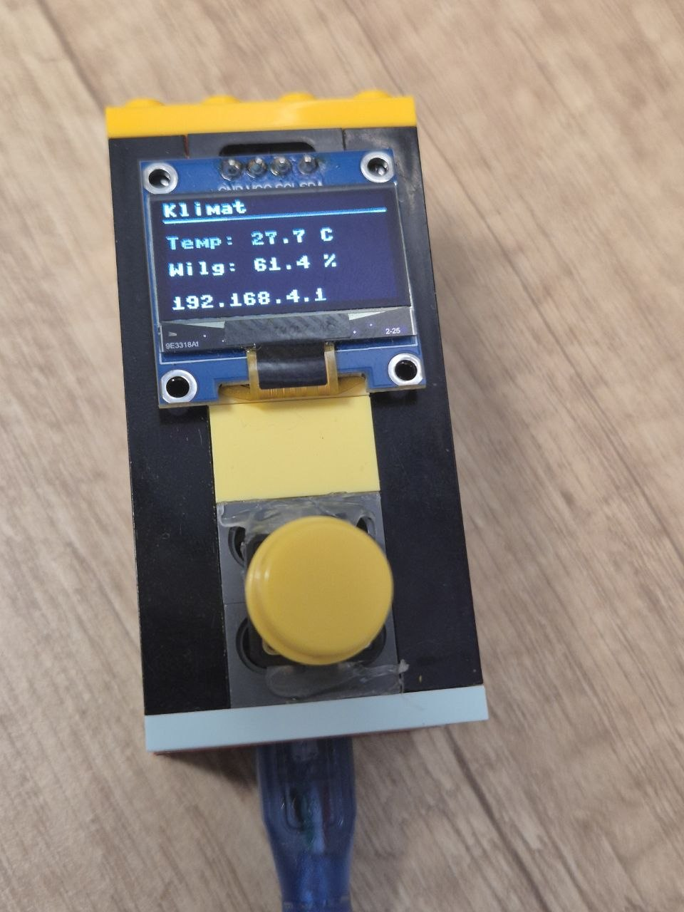
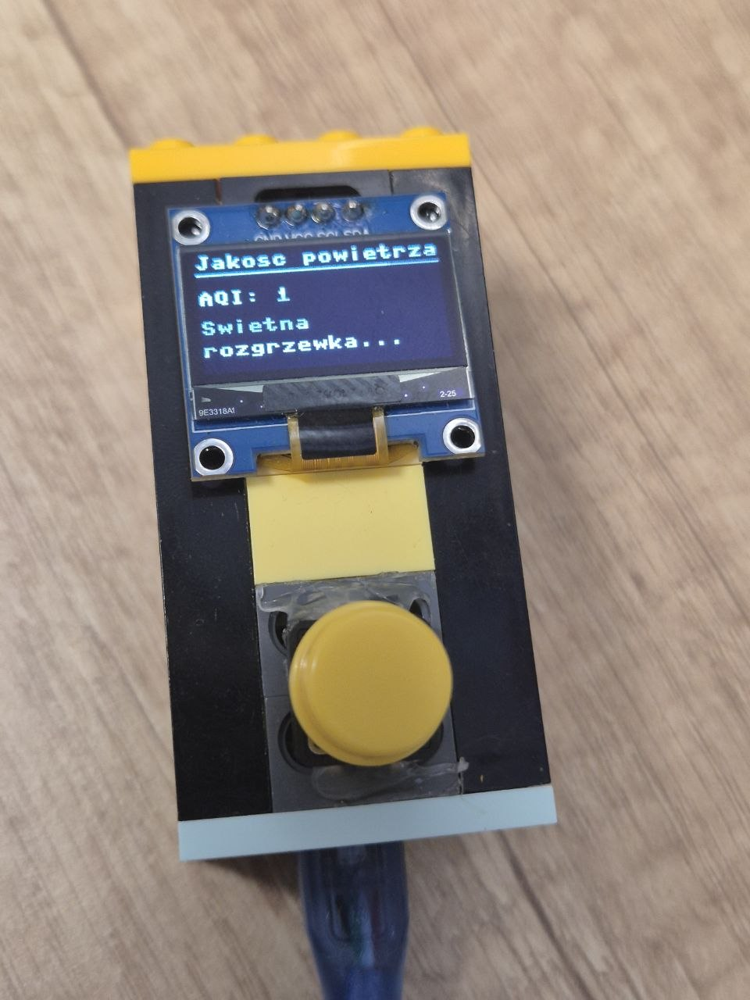
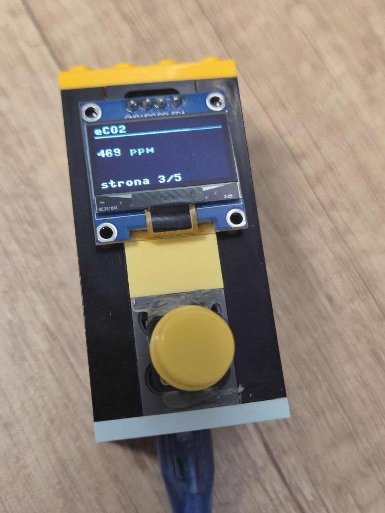
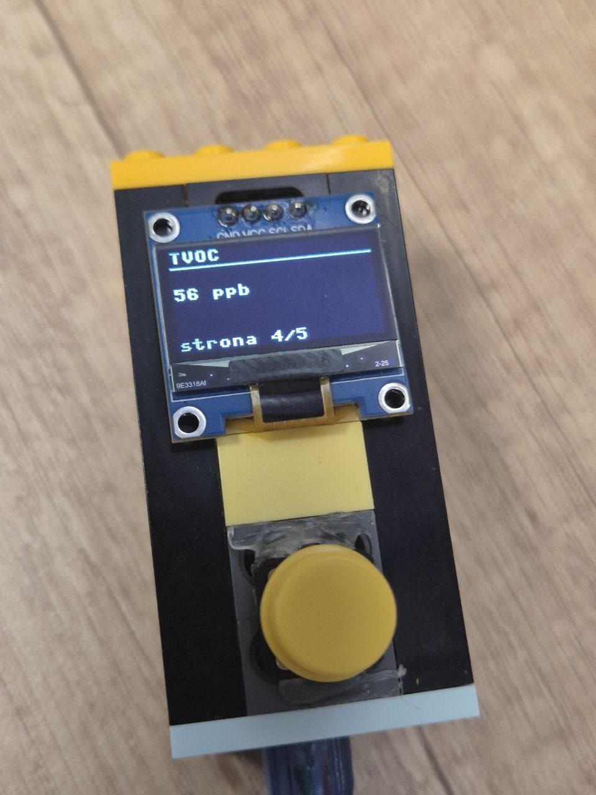
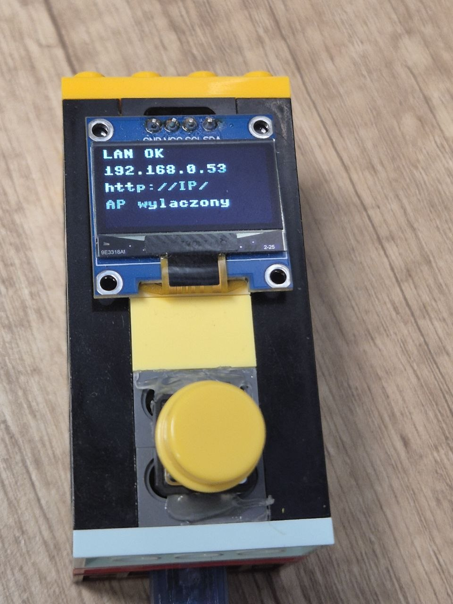
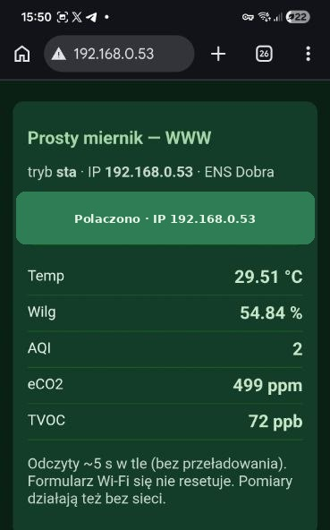
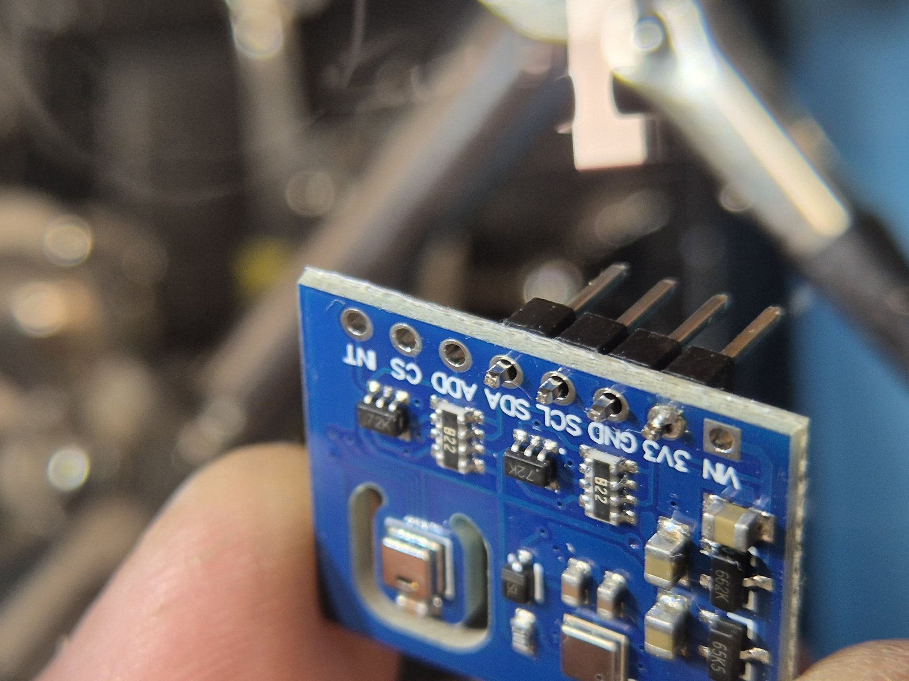

# Pico W · OLED + panel w sieci domu

Linia **MiernikPowietrzaPico**.

**Prosty miernik powietrza** na Raspberry Pi Pico W — temperatura, wilgotność i jakość powietrza na małym ekranie **oraz** w przeglądarce telefonu albo komputera.

Język dokumentacji: **polski**. Kod: **MicroPython**.
Cel: żeby inny majsterkowicz mógł to powtórzyć u siebie.

Obudowa na zdjęciach to **klocki LEGO** (kilkanaście sztuk, okienka z zestawu z lat 90.). Prototyp, który da się przenieść — jeszcze nie obudowa do tunelu.

To samo pudełko, dwa sposoby odczytu:

| Jak odpalasz | Co dostajesz |
|--------------|----------------|
| `main_oled_only.py` | tylko ekranik, **bez Wi‑Fi** |
| `main.py` | Pico stawia własną sieć → telefon → panel → potem Twoja sieć w domu |

Nie ma chmury, konta ani „z dowolnego miejsca na świecie”. Panel jest **lokalny**: zwykłe `http://` (nie kłódka), sieć **2,4 GHz** (Pico nie widzi 5 GHz). Zasilanie: **USB 5 V**, nie 230 V.

Historia sukcesu **bez laptopa**: OLED pokazuje nazwę sieci urządzenia, hasło urządzenia i adres — otwierasz to na telefonie.

Poprzedni odcinek (sam ekranik, bez sieci): [Pico-Prosty_miernik_powietrza](https://github.com/GrzesiekHobby/Pico-Prosty_miernik_powietrza).

> **Not Polish?** Use your browser **Translator** on this page.


**Wątek budowy na X (OLED):** [od zera do działającego OLED](https://x.com/GrzesiekHOBBY/status/2114417301910966423)

## Co widać na OLED i w przeglądarce

| Strona | Znaczenie |
|--------|-----------|
| Klimat | temperatura °C, wilgotność % |
| Jakość powietrza | ocena AQI 1–5 po polsku (im wyżej, tym gorzej na skali tego czujnika). Na starcie często „rozgrzewka…” — **liczba (nawet 1) w tym momencie nic nie znaczy**. Czujnik musi się nagrzać (~3 minuty). |
| eCO2 | **szacunek** z czujnika ENS160, **nie** laboratoryjny CO₂ |
| TVOC | zbiorczo lotne związki organiczne, nie nazwa jednego gazu |
| Sieć | najpierw hotspot urządzenia, potem IP w sieci domu |

Przycisk (żółty): następna strona. Pomiar na OLED działa także wtedy, gdy Wi‑Fi nie jest połączone.

OLED i telefon to **dwa ekrany**. Nie porównuj °C z jednego kadru z °C z telefonu z innej minuty.

Poza hotspotem OLED gaśnie po **60 s** (przycisk budzi). W hotspotcie ekran **nie** zasypia, żeby dało się odczytać hasło urządzenia. Ta sama liczba jest we wzorze [`secrets.py.example`](secrets.py.example).










## Części

| # | Część | Uwagi |
|---|--------|--------|
| 1 | Raspberry Pi Pico W | z pinami albo do dolutowania |
| 2 | Moduł AHT21 + ENS160 | jedna płytka „combo” |
| 3 | OLED 0,96″ I2C | zwykle 128×64, 4 piny |
| 4 | Przycisk taktylny | 6×6 mm |
| 5 | Płytka / obudowa | u mnie 13 klocków LEGO |

## Piny (dwie osobne szyny)

Żeby ekran i czujniki się nie gryzły, każde ma swoją parę przewodów.

| Urządzenie | GP | Zasilanie |
|------------|-----|-----------|
| OLED | **GP0** / **GP1** | 3,3 V + GND |
| AHT21 + ENS160 | **GP2** / **GP3** | **3,3 V** (nie VIN) + GND |
| Przycisk | **GP15** ↔ GND | — |

Adresy: OLED `0x3C`, AHT `0x38`, ENS `0x53`. Mapa: [`pins.py`](pins.py).



## Od OLED do telefonu

Na ekranie (wolno cytować):

```text
HOTSPOT
Miernik-Pico
miernik123
192.168.4.1
```

1. Zasil USB. OLED sam pokazuje nazwę, hasło **urządzenia** i adres.
2. Telefon: Wi‑Fi **2,4 GHz** → sieć `Miernik-Pico`.
3. Przeglądarka: `http://192.168.4.1/` (nie https).
4. W panelu wybierz sieć domu **2,4 GHz**; hasło tylko w formularzu (zostaje na płytce, nie na OLED).
5. Hotspot **gaśnie**. Na OLED nowe IP. Telefon wraca na Wi‑Fi domu → `http://TO-NOWE-IP/` (u Ciebie będzie inne niż na zdjęciach).

Wzór: [`secrets.py.example`](secrets.py.example). Prawdziwego `secrets.py` **nie wgrywasz do Gita**.

## Gdy coś nie działa

- Telefon na 5 GHz, sieć „Gość” albo VPN — często nic nie otworzy.
- Po połączeniu z domem strona pada: telefon jeszcze siedzi na sieci Pico. Wróć na Wi‑Fi domu i wpisz **nowy** adres z OLED.
- Ekran milczy, a skan adresów był „OK”: w klockach kabelki lubią się rozjechać. W kodzie magistrala jedzie wolniej (**100 kHz**). **USB wyłącz na 5 sekund**, sprawdź styki, nie podmieniaj od razu plików.
- Pusty skan → okablowanie.

Czujnik jakości: pierwsze **~3 minuty** „rozgrzewka…” — normalne. **AQI w rozgrzewce nie jest werdyktem** („1” nie znaczy „super powietrze”). eCO2 to nie laboratoryjny CO₂.

## Montaż w Thonny (krok po kroku)

1. MicroPython na Pico W.
2. Pliki `.py` z tego repo na Pico.
3. Po kolei (Stop przed następnym): `test_i2c_skan.py` → `test_przycisk.py` → `test_oled.py` → `test_czujniki.py`.
4. Sam ekran: `main_oled_only.py`. Panel: `main.py`.

## Licencja

[MIT](LICENSE). Linia **MiernikPowietrzaPico** · Grzesiek Hobby · X: [@GrzesiekHOBBY](https://x.com/GrzesiekHOBBY)
